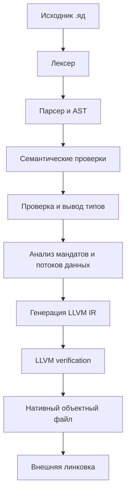

# YadroLang (ЯДРО)

[](https://github.com/vadesxl/YadroLang/actions/workflows/run.yml)
[](https://github.com/vadesxl/YadroLang/releases/latest)

YadroLang - язык с русским синтаксисом и компилятор на Python, который проверяет политику доступа и потоки чувствительных данных до генерации LLVM IR. Репозиторий также содержит Yadro Guard - CLI для анализа исходников `.яд` и статических графов инструментов в собственной схеме Yadro MCP.

Задача проекта - исследовать, как явные разрешения на операции и анализ потоков данных помогают обнаруживать нарушения заданной политики до сборки программы. Проверки основаны на объявленных источниках данных, стоках, метках и правилах деклассификации.

## Реализованные возможности

- Функции, локальные переменные, рекурсия, `если`/`иначе`, `пока`, арифметика, `ц64` и `булево`; прямая печать строк.
- Генерация LLVM IR с проверкой корректности модуля и выпуск нативного объектного файла. Линковка выполняется отдельно.
- Capability-мандаты для операций и межпроцедурный анализ явных и неявных потоков данных: метки ПДн, финансов, здоровья, учетных данных и локации.
- Санитайзеры с разрешенной деклассификацией по меткам, сводки вызовов, объединение ветвей и ограниченные итерации анализа циклов.
- CLI с текстовыми, JSON и SARIF 2.1.0 результатами; пользовательские политики в JSON.
- Статический анализ графа Yadro MCP: распространение меток, выявление чувствительных потоков к привилегированным инструментам и эвристика избыточных полномочий.

## Конвейер компилятора



Выявленные анализатором нарушения политики отклоняются до генерации LLVM IR. LLVM verification проверяет корректность промежуточного представления; покрытие анализа и известные пробелы описаны ниже.

## Быстрый старт

Требуются Python 3.11+ и версия `llvmlite`, закрепленная в `requirements.txt`.
Команды ниже относятся к ветке `main`; ее отличие от опубликованного релиза указано в разделе «Релиз».

```bash
git clone https://github.com/vadesxl/YadroLang.git
cd YadroLang
python -m pip install -r requirements.txt

# Проверить исходник и вывести LLVM IR
python -m src.main examples/тест.яд --ir
```

Для выпуска объектного файла выполните:

```bash
python -m src.main examples/тест.яд
```

Результат по умолчанию - `ядро.o`. На Linux и macOS используется нативная цель LLVM. Для выпуска AMD64 COFF на Windows требуется поддерживаемый Clang/LLVM toolchain в `PATH`. Создание исполняемого файла требует отдельной линковки; внешние API также требуют соответствующей реализации [ABI](https://github.com/vadesxl/YadroLang/blob/main/ABI.md).

### Самодостаточная программа

Сохраните следующий исходник в `hello.яд`:

```text
функ старт() {
    печать("Привет, YadroLang!")
    печать(42)
}
```

```bash
python -m src.main hello.яд --ir
```

Программа содержит единственную точку входа `старт()` без параметров и использует встроенную `печать`.

## Yadro Guard CLI

Установка из клонированного репозитория:

```bash
python -m pip install .
yadro-guard version
yadro-guard scan examples/тест.яд --format json
yadro-guard mcp scan tests/fixtures/mcp-clean.json --format json
```

Для исходников доступны команды `scan`, `compile`, `audit`, `policy check` и `version`. Форматы результатов - `text`, `json`, `sarif`. Дополнительная команда `yadro-guard-mcp` запускает тот же сканер графов.

Пользовательская политика задает источники, стоки и санитайзеры с разрешенным снятием меток; она применяется к одному вызову CLI. Формат описан в [POLICY_SPEC.md](https://github.com/vadesxl/YadroLang/blob/main/POLICY_SPEC.md), команды - в [CLI.md](https://github.com/vadesxl/YadroLang/blob/main/CLI.md).

Сканер графов принимает [статическую схему Yadro MCP v1.0](https://github.com/vadesxl/YadroLang/blob/main/MCP_SCHEMA.md). Граф задается явно через инструменты, метки, полномочия и ребра потоков.

## Демонстрации политики

- [опасный.яд](https://github.com/vadesxl/YadroLang/blob/main/examples/опасный.яд) - операция без требуемого мандата.
- [утечка.яд](https://github.com/vadesxl/YadroLang/blob/main/examples/утечка.яд) - чувствительные данные достигают стока без разрешенной деклассификации.
- [безопасный.яд](https://github.com/vadesxl/YadroLang/blob/main/examples/безопасный.яд) - пример с мандатом и санитайзером, принимаемый анализатором.

Принятие исходника анализатором относится к заданной политике и модели данных. Работу внешнего санитайзера необходимо обеспечить в среде исполнения.

## Состояние и ограничения

YadroLang развивается как экспериментальная реализация компилятора и статического анализа политик. В репозитории опубликованы [матрица возможностей](https://github.com/vadesxl/YadroLang/blob/main/FEATURE_STATUS.md) и [модель угроз](https://github.com/vadesxl/YadroLang/blob/main/THREAT_MODEL.md).

### Известные пробелы анализа в main

Для проверенного `main` [`d59cd6f2`](https://github.com/vadesxl/YadroLang/commit/d59cd6f20b92e844ee80c873240f50a1f637a0d2) опубликован [разбор flow gaps](https://github.com/vadesxl/YadroLang/blob/771e6613baf1d9edbe7fe3b82c13d3077fa4e78a/docs/analysis/flow-gaps.md). Он описывает неполное покрытие выходных потоков и зависимостей от чувствительных условий:

- `печать` отсутствует в таблице стоков текущего анализатора. Для вывода чувствительных данных через нее гарантированная блокировка не реализована.
- Возвращаемое значение `старт()` выводится LLVM wrapper вне проверки стоков в теле программы.
- Метки чувствительных условий не всегда передаются присваиваниям и возвратам; документ также описывает пробелы анализа циклов и ложные срабатывания после очистки данных в обеих ветвях.

Успешная компиляция означает принятие программы текущими проверками и прохождение LLVM verification. Покрытие анализа остается неполным из-за перечисленных пробелов.

Исправления потокового анализа 1-6 находятся в отдельной ветке [`compiler-fix-working`](https://github.com/vadesxl/YadroLang/commit/dff62f8a959ef0b5b8d14fcd6fb069c7aaddfc40). Обновление документации подготовлено в [`docs-readme-2.1.0`](https://github.com/vadesxl/YadroLang/commit/9dfcdeebf90ba638bd52215d2703215548244c09). В проверенной истории эти изменения не вошли в `main` и не являются возможностями релиза v2.1.0.

### Другие ограничения

- Полноценная модель памяти и строк, ownership и runtime ABI library пока не поставляются. Хранение и возврат строк не поддерживаются.
- Анализ исходит из объявленных меток и доверия к внешним реализациям санитайзеров. Он не устанавливает этичность поведения ИИ и не подтверждает соответствие GDPR, HIPAA или PCI DSS.
- Динамическое переполнение `i64` проверяется не полностью; компрометация среды исполнения, LLVM и микроархитектурные побочные каналы находятся вне заявленных гарантий.
- MCP-анализ работает с документированной схемой Yadro; импорт произвольных конфигураций серверов и адаптеры агентных фреймворков пока не реализованы. Проверка избыточных полномочий является эвристикой.
- [Proof Seal](https://github.com/vadesxl/YadroLang/blob/main/PROOF_SEAL_IMPLEMENTATION.md) имеет модель evidence и библиотечную проверку согласованности неподписанных данных. Экспорт доказательных артефактов из CLI, привязка нативного объекта и подтверждение подлинности еще не реализованы.

Результаты `audit` служат техническими данными о работе анализатора. Интерпретация результатов зависит от политики, модели угроз и внешних компонентов.

## Релиз

Последний опубликованный релиз - [v2.1.0](https://github.com/vadesxl/YadroLang/releases/tag/v2.1.0) от 10 июля 2026 года. Он включает анализатор v2.1, доработки типизации и LLVM, CLI и сканер Yadro MCP. На странице релиза доступны архивы исходников; готовые бинарные вложения не опубликованы.

Тег v2.1.0 указывает на [`260885e9`](https://github.com/vadesxl/YadroLang/commit/260885e9a4786743e9fec5fcd5c16b0451f766a1). Этот README описывает проверенный `main` [`d59cd6f2`](https://github.com/vadesxl/YadroLang/commit/d59cd6f20b92e844ee80c873240f50a1f637a0d2) от 11 июля 2026 года, включающий последующие доработки. Обозначение версии пакета осталось 2.1.0, но релиз и `main` являются разными снимками кода. Подробности - в [CHANGELOG.md](https://github.com/vadesxl/YadroLang/blob/main/CHANGELOG.md).

## Лицензия и участие

Лицензия проекта - **GPL-3.0-only**. Текст лицензии находится в [LICENSE](https://github.com/vadesxl/YadroLang/blob/main/LICENSE), обозначение лицензии пакета - в [pyproject.toml](https://github.com/vadesxl/YadroLang/blob/main/pyproject.toml). GPL допускает коммерческое использование при соблюдении ее условий.

Правила участия - в [CONTRIBUTING.md](https://github.com/vadesxl/YadroLang/blob/main/CONTRIBUTING.md).

